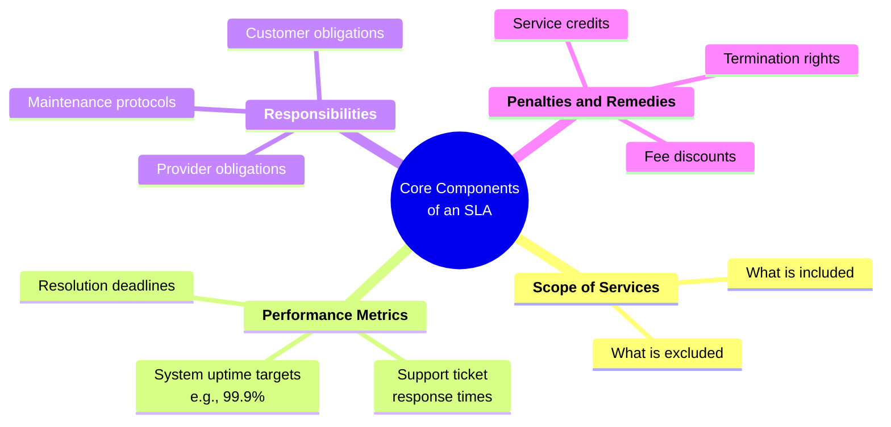

# SLA (Service Level Agreements)

## Definition / Formula

An SLA stands for a Service Level Agreement. It is a formal, binding contract or agreement between a service provider and a customer (or between two internal departments) that defines the exact level of service expected to be delivered

Anchored by four core pillars: a defined **scope of services**, measurable **performance metrics** (such as a 99.9% uptime baseline or tier-based helpdesk response deadlines), clearly outlined **provider and customer obligations**, and pre-negotiated **penalties and remedies** (like service credits or termination clauses).

For complex ecosystems, organizations leverage a **multi-level SLA** to bundle various commitments into a single framework. This structured methodology breaks agreements down into three cohesive layers: **corporate-level policies** that apply globally, **customer-level agreements** customized for specific client groups, and **service-level metrics** tied directly to individual tools or assets. Together, these frameworks establish high accountability, streamline operations, and minimize redundancy across diverse workflows.

## Explanation

An SLA typically outlines:
- **Scope of Services:** What is included and what is excluded.
- **Performance Metrics:** Measurable targets such as system uptime (e.g., 99.9%), response times for support tickets, and resolution deadlines.
- **Responsibilities:** What both the provider and the customer must do to maintain the service.
- **Penalties and Remedies:** What happens if the provider fails to meet the agreed standards, such as service credits, fee discounts, or a right to terminate the contract. 

Common Types of SLAs

- **Customer SLA:** An agreement between a service provider and an external client.
- **Internal SLA:** An agreement between different teams or departments within the same company (e.g., a sales team and a marketing team).
- **Multi-Level SLA:** A layered agreement that covers various customer segments, multiple support tiers, or a mix of internal and external stakeholders. 

### Example 1: Cloud Uptime Example (IT & SaaS)

An enterprise cloud hosting provider (like Amazon Web Services or Microsoft Azure) signs an agreement with an online retail company.

- **The Promise:** The cloud server will maintain **99.9% uptime** each month.
- **The Math:** 99.9% uptime allows for roughly 43.8 minutes of unplanned downtime per month. If the server crashes for 5 hours due to a provider failure, they have breached the SLA.
- **The Penalty / Remedy:** The agreement states that if uptime drops between 99.0% and 99.8%, the customer gets a **10% service credit** on their next monthly bill. If it drops below 95%, they receive a **50% to 100% refund/credit** for that month.

### Example 2 : Helpdesk Response & Resolution Example (Internal or B2B IT Support)

An internal IT department or an external managed service provider (MSP) supports a company's employees. The SLA sets strict reaction times based on how badly a problem hurts the business:

- **Severity 1 (Critical – e.g., entire office internet is down):**
    
    - _Response Time:_ Within **15 minutes** (an engineer must acknowledge and start working).
    - _Resolution Target:_ Within **4 hours**.
    
- **Severity 3 (Low – e.g., a printer isn’t connecting on the 2nd floor):**
    
    - _Response Time:_ Within **4 business hours**.
    - _Resolution Target:_ Within **2 to 5 business days**.
    
- **The Remedy:** If Severity 1 issues regularly miss the 4-hour fix window without a valid excuse, the contract allows the client to escalate to senior management or withhold a portion of the monthly retainer.

### Example 3 : Customer Service / E-Commerce Chatbot Example

An online banking or retail platform guarantees customer service quality for incoming queries:

- **First-Response Time:** 95% of live-chat or email queries must receive a human or automated response within **2 minutes**.
- **First-Contact Resolution (FCR):** At least **75% of customer issues** must be completely solved on the first interaction without needing a callback or transfer.
- **Abandonment Rate:** Fewer than **3% of callers** should hang up before reaching an agent.
- **The Remedy:** If the provider misses these metrics for two consecutive quarters, the business can penalize the vendor or put the contract up for re-bidding.

4. Multi-Level SaaS Tier Example (Corporate, Customer, and Service)

A software company sells a project-management tool to a large hospital network:

- **Corporate Level:** Applies to everyone—all users must connect using **TLS 1.2+ encryption** and comply with local data-privacy laws.
- **Customer Level:** Applies specifically to the Hospital Group—they receive a dedicated Account Manager and **24/7 priority phone support**.
- **Service Level:** Applies to the specific Radiology Imaging module inside the software—it guarantees a **99.99% uptime** and database search response times under **1 second**.
