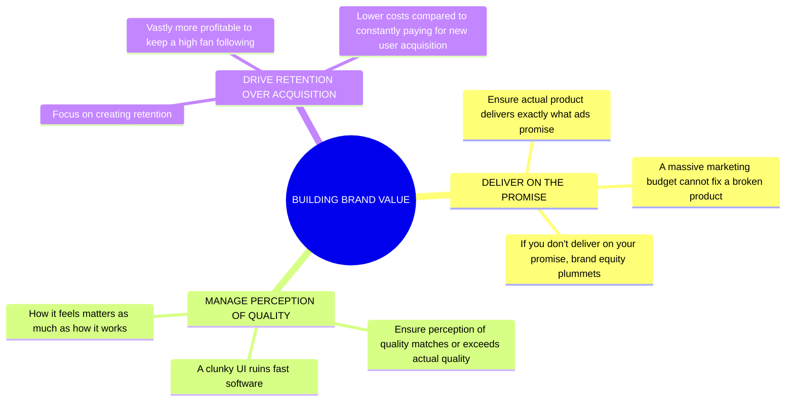

# Brand equity and value

## Definition / Formula

A brand is a psychological promise, Brand Equity is how deeply your audience believes that promise, and Brand Value is the financial reward you get for keeping it. Consumers face intense decision fatigue every day. If someone is buying a new smartphone, they don't have the time or energy to read the specs, compare different modes, or benchmark the processors. Instead, their brain uses a shortcut: _Apple means premium and easy to use. Samsung means cutting-edge tech._

## Explanation

To clear up a common trap right away: **Brand value _is_ a monetary value.** It is the literal financial amount your brand would sell for if you put it on the open market. Brand equity is the perceived worth of the brand in the customer's mind.

A generic company needs to fight for every single sale using discounts, performance specs, and expensive ad campaigns. But if a company has high brand value, marketing becomes infinitely cheaper and more effective. Brand equity allows you to:

- **Charge a premium:** People pay $150 for a Nike shoe that costs $15 to make.
    
- **Launch new products easily:** When Sony launches a new PlayStation, millions pre-order it before seeing a single frame of gameplay, purely on trust.
    
- **Survive mistakes:** If a trusted brand ships a buggy update, users wait for a patch. If an unknown brand does it, users immediately refund and leave a negative review.

### Building the brand equity
- Ensure the actual product delivers exactly what your ads promise. A massive marketing budget cannot fix a broken product. If you don't deliver on your promise, brand equity plummets.

- Ensure the _perception_ of quality matches or exceeds the actual quality. It doesn't matter if your software is objectively 10% faster than the competitor if the user interface looks clunky

- Focus on creating retention. It is vastly more profitable to keep a high fan following than to constantly pay for new user acquisition

### Quantifying value of a brand
The brand value refers to the amount at which the brand could be sold in open market. There are few methods to calculate it

- `Cost-Based Approach`: Calculating how much it would cost to build that exact brand from scratch today. You add up all historical marketing, design, advertising, and R&D expenses that went into creating the brand's current status.   

- `Market-Based Approach`: Looking at what similar brands in your industry recently sold for. It is exactly like looking at "comps" when selling a house—if a rival software company with similar market share sold its trademark for $50 million, yours is likely in that ballpark.   

- `Income-Based Approach`: Calculating the extra future cash flow the brand generates. If a generic mechanical keyboard sells for $40 and a Razer keyboard with the exact same specs sells for $120, the brand is generating $80 of premium income per unit. You forecast that extra income over several years and discount it to present value.   

### Explaining the income based approach
If a generic mechanical keyboard sells for $40 and a Razer keyboard with the exact same specs sells for $120

- **The Premium:** The hardware is $40, but the logo adds an $80 psychological tax per sale.
- **The Yearly Run-Rate:** Selling 1 million keyboards means the brand alone prints an extra $80 million annually.
- **The Future Total:** Over 5 years, that is $400 million in bonus cash a generic competitor misses out on.
- **Time Value of Money:** Future money is worth less than today's money because you cannot invest it right now, and consumer hype is always a risk.
- **The Discount:** Accountants mathematically shrink that risky future $400 million into today's money, officially valuing the brand at a lump sum of $320 million right now.
