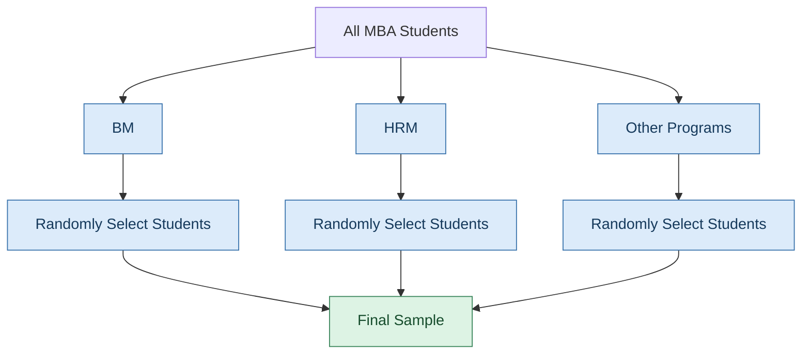
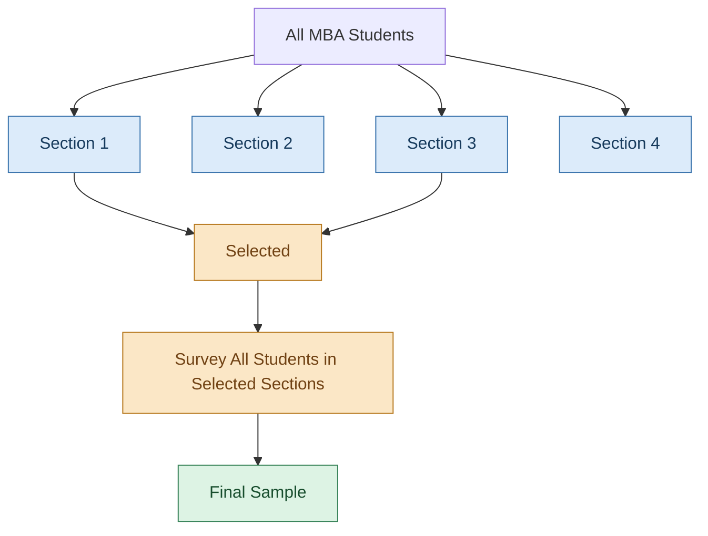
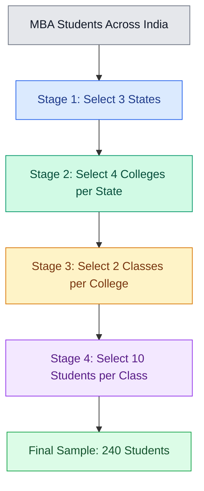

# Cluster vs Stratified sampling

## Definition / Formula

Sampling is the process of selecting a subset of a population to draw conclusions about the whole. It saves time, cost, and effort while making research practical. The key methods include stratified sampling, which takes samples from every group; cluster sampling, which studies selected groups; and multi-stage sampling, which selects samples in multiple steps, from larger groups to smaller units.

## Explanation

Cluster sampling and stratified sampling differ mainly in what you select and why you select it. In stratified sampling, you divide the population into groups and sample from every group, while in cluster sampling, you divide the population into groups and select only some groups for study.

Imagine XLRI has 1,000 students across different programs and years. You want to survey students about campus life, so you need a way to select a manageable sample.

### Stratified sampling
Take some students from every group. Divide the students into **strata**, such as `BM (Business Management)`, `HRM (Human Resource Management)`, and other programs, then randomly select students from each group. This ensures every program is represented in your sample.

### Cluster sampling
Divide the students into clusters, such as year (first year or second year), sections etc. You survey students in those selected sections rather than sampling from every section. Ideally, each cluster reflects the wider population. 

### Summary of these methods

| Basis          | Stratified sampling                         | Cluster sampling                                    |
| -------------- | ------------------------------------------- | --------------------------------------------------- |
| Selection      | Some members from every stratum             | Some clusters from the population                   |
| Groups         | Similar members within each stratum         | Ideally, each cluster reflects the wider population |
| Main objective | Ensure representation and improve precision | Reduce cost and effort                              |
| Example        | Students sampled from every program         | A few tutorial sections selected                    |

> [!tip]
> Stratified means all groups represented; cluster means some groups selected

### Cluster Sampling Iteratively
After creating clusters, we can further create clusters to pinpoint the criteria of people we need. Imagine you want to survey MBA students across India, but you cannot visit every college, so you randomly select 3 states, then 4 colleges in each state, then 2 classes in each college, and finally 10 students from each class. You have selected your sample through four stages, giving you \(3 \times 4 \times 2 \times 10 = 240\) students.

